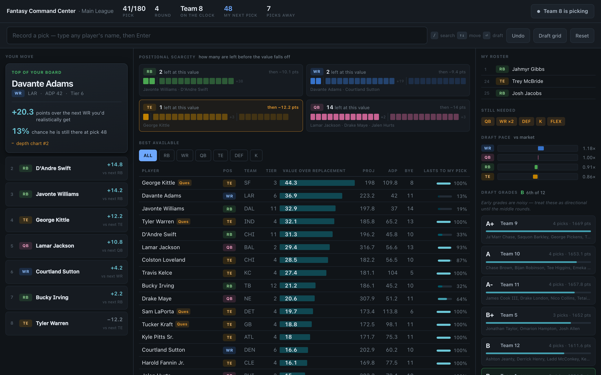
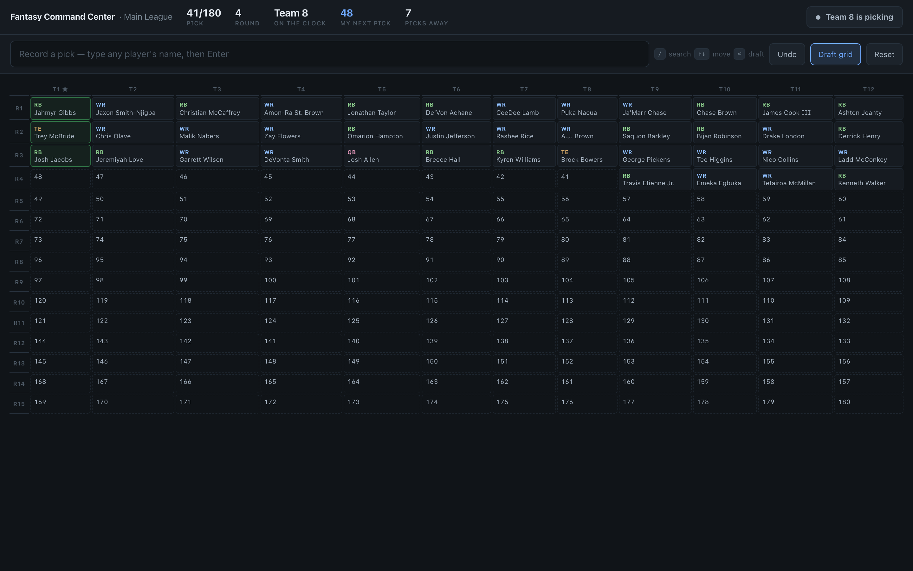
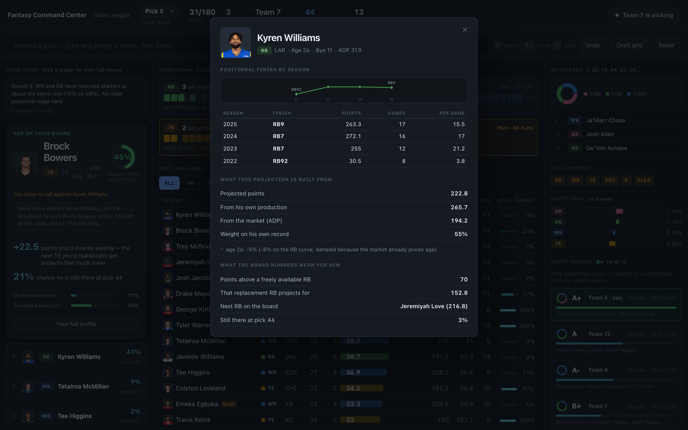

# Fantasy Command Center

A live fantasy football draft assistant. Enter every pick as it happens and it
recalculates what you should do next, how likely each player is to survive to
your next real decision, and a decomposed draft grade for every team in the league.

Built on free, public data only — no paid API keys, no scraping.



The tier ladder across the top is the fastest read on the page: how many players
are left at the current value, and how far the drop is once they're gone.



---

## Why it exists

Static cheat sheets can't answer the only question that matters mid-draft:
**what do I actually lose by waiting?** That depends on who's likely to be gone
by your next pick, which depends on how *your* room is drafting right now.
This tool models that explicitly.

## What it does

**Projections built from raw stat lines.** Fantasy points are computed from
nflverse weekly stats (27 seasons, 1999–2025) under your scoring config, not
read from a canned PPR column. Changing to half-PPR or adding a TE premium is
a config edit, not a rewrite.

**Value over replacement, from your league settings.** Replacement level comes
from `teams × starters`, with flex distributed across eligible positions. This
is why the board correctly ranks Bijan Robinson above Bo Nix even though Nix
projects for more gross points.

**Survival probability.** Each player's draft position is modelled as a shifted
log-normal moment-matched to FFC's ADP and standard deviation, with a hard
floor at their earliest observed pick. Two players with the same ADP can have
very different survival odds — Ashton Jeanty and Derrick Henry sat at ADP 17.6
and 17.4 in testing, but 13.6% vs 4.0% to last to pick 24, because Jeanty's
variance is double. No rank-ordered cheat sheet can express that.

**It learns your room.** A per-position hazard multiplier is refit from the
picks actually entered. When eight of nine picks are running backs, RB pace
reads 1.44× and every RB's survival estimate drops accordingly. FFC ADP
describes the internet's average draft; this corrects toward yours.

**VONA, measured past the turn.** At a snake turn you hold back-to-back picks,
so "who survives to my next pick" is a trivial question — everyone does. The
recommender skips consecutive picks and measures against your next *separated*
pick instead.

**Draft grades for every team, decomposed.** Starting-lineup projection (with
forward credit for unfilled slots, so grades mean something before round 8),
value above draft slot, and roster-fit penalties. Always shown as components
with a confidence level, never a bare letter.

## Quick start

```bash
uv venv --python 3.13
uv pip install -e .

# Pull and cache every source; verifies all draftable players resolve.
ffcc snapshot

# Run the board
ffcc serve          # → http://127.0.0.1:8000
```

Run `ffcc snapshot` the morning of your draft. Everything is cached to disk,
so a network problem mid-draft degrades to stale data rather than a dead tool.

```bash
ffcc board --pos RB --limit 30     # print the board to a terminal
```

## Picking your draft slot

Set it from the picker in the header — no config editing, and it can be changed
mid-draft. Everything re-derives from it: which picks are yours, every survival
probability, the recommendation horizon, and the grades. Your choice is written
back to `config/league.yaml` so it survives a restart.

## Player profiles

Click any player for their full record. Shift-click drafts instead.



Up to seven seasons of positional finish, drawn on a log scale because RB1 → RB3
is a small move at the elite end while RB30 → RB10 is a large one. Below it: the
season table, what the projection is built from, and what each board number
means for that specific player — the replacement he is measured against, and the
next player at his position you'd get instead.

## Reading the board

**Tier ladder.** One lane per skill position. Blocks are the players still
available, grouped by tier; the gaps are the value cliffs. "1 left, then −43
pts" is the whole argument for taking a quarterback now rather than in two
rounds. DEF and K are excluded — they have no meaningful tiers.

**Value bars.** Value over replacement, drawn as length. Scanning a column of
bars is faster than comparing numbers under a clock.

**Lasts-to-my-pick meters.** Survival probability on a sequential ramp. It is a
magnitude, not a status, so it never borrows the reserved warning colors — and
it is measured against the pick that waiting actually costs you, not the next
pick in a back-to-back turn.

**Draft pace.** How fast each position is leaving relative to market ADP, with
1.00× as the centre line. Above it, that position is running hot.

**Roster shape donuts.** Positional make-up of each roster — the one question
on this board that is genuinely part-to-whole rather than "how much". Survival
stays a meter and value stays a bar for exactly that reason.

**Pick probability.** Two numbers, because they answer different questions.
*Simulated best pick* forces each candidate, plays the draft forward, and counts
how often it produced your best roster. *Model preference* is the value model's
share. When they disagree the board says why — usually a tier cliff. When two
candidates are statistically tied it says that too, rather than inventing a
winner. This is model output, not a poll of experts.

**Age curves.** Fitted from paired within-player year-over-year deltas, not the
average by age — that version is survivorship-biased and claims receivers peak
at 21. The paired method recovers the real running-back cliff (−14% at 27→28,
−26% at 28→29) and shows quarterbacks aging best.

**Round insight.** Nine seasons of ADP joined to actual finishes: how often a
pick from this round returned a startable season, by position. Not "what
champions drafted" — championship rosters aren't available anywhere free, and
inventing them would be worse than silence.

**Draft grid.** Every pick as rounds × teams, cells filled by position with
round.pick labels and snake-direction arrows, your column outlined. The fastest
way to see a positional run forming.

## Using it live

Type the player's name in the search box and press Enter to record a pick — for
**any** team, not just yours. `/` focuses the box, `↑↓` selects, `Esc` clears,
and `Undo` reverses a mis-entry. Clicking a row on the board or a recommendation
card also drafts that player.

The `Lasts?` column is the probability that player is still there at your next
real decision point.

## Configuration

`config/league.yaml` holds team count, roster slots, scoring weights, and your
draft slot. **Set `my_draft_slot` before drafting** — every survival and VONA
number depends on it. `config/overrides.yaml` takes manual player ID fixes if
the resolver ever reports one.

## Data sources

| Source | Auth | Used for |
|---|---|---|
| Fantasy Football Calculator | none | ADP + stdev/high/low from ~8k drafts |
| nflverse | none | 27 seasons of weekly stats, ID crosswalk, depth charts |
| Sleeper | none | player metadata, live injury status |
| DynastyProcess (FantasyPros mirror) | none | expert consensus + dispersion, deep board |

**Yahoo** is deliberately *not* on the critical path. Its API now requires a
reviewed application with no guaranteed timeline, so history import works today
via manual CSV (`config/history_template.csv`) and the Yahoo adapter slots in
behind the same interface if access arrives. The resolver already carries
`yahoo_id` for that purpose.

## Honest limitations

- **FFC ADP ignores league size.** `teams=10`, `12`, and `14` return identical
  values — it's a pooled blend. Away from 12 teams, treat ADP as
  approximate.
- **Projections blend our model with the market, deliberately.** ADP is itself
  a crowd projection from thousands of drafts. Claiming to beat it outright
  would be overconfident; the weight on our own history scales with how much
  evidence a player actually has, and rookies fall back to market entirely.
- **Early draft grades are noisy.** That's why confidence is displayed and why
  unfilled starter slots get forward credit. A precise-looking letter grade at
  pick 20 would be false precision.
- **DEF and K are modelled crudely on purpose.** They're close to
  interchangeable and the tool will tell you not to draft them early.

## Development

```bash
pytest -q
```

31 tests cover snake-order and roster math, name normalization across sources,
the survival model's mathematical properties (monotonicity, bounds, hazard
response), the turn-horizon logic, and scoring validated against a known real
outcome — McCaffrey's 416.6 PPR points in 2025.

## Layout

```
src/ffcc/
  sources/      ffc, nflverse, sleeper, ecr, crosswalk, cache
  identity/     resolver, normalize
  projections/  scoring, baseline, market, blend, vor
  draft/        state, survival, vona, needs, lineup, recommend, grade
  history/      schema, importers/
  web/          FastAPI app + board UI
```


## Cleanup behavior and validation limits

Draft journals are scoped by league/session configuration and replaced atomically. A process file lock enforces a single web worker; in-process changes are serialized. Do not run multiple application workers against one journal. A truncated final journal line is recoverable with a warning; invalid interior records fail visibly.
